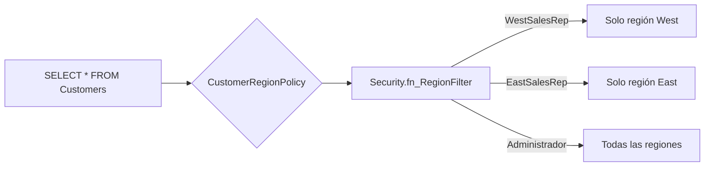

# 🔐 M1 · Seguridad de datos y cumplimiento

**Implementar seguridad de datos y cumplimiento con SQL**

---

## 📌 De qué trata

Laboratorio de protección de datos sensibles en Azure SQL Database con dos controles que se complementan:

- **Enmascaramiento dinámico de datos (DDM):** oculta valores sensibles en los resultados de las consultas a los usuarios sin permiso `UNMASK`, sin modificar lo que está almacenado.
- **Seguridad a nivel de fila (RLS):** filtra las filas que ve cada usuario según su región de ventas, mediante una función de predicado y una directiva de seguridad.

Juntos aplican el principio de **defensa en profundidad**: un usuario solo ve sus filas y, dentro de ellas, los datos sensibles enmascarados.

## 📂 Contenido

| Archivo | Descripción |
|---|---|
| [`scripts/M1-lab-security-compliance.sql`](scripts/M1-lab-security-compliance.sql) | Script completo del laboratorio: tablas, datos de ejemplo, DDM, RLS y limpieza |

## 🧩 Qué se puede observar en el script

### 1. Tablas de ejemplo
`dbo.Employees` (correo, SSN, salario) y `dbo.Customers` (teléfono, tarjeta, región de ventas) con datos de prueba.

### 2. Enmascaramiento dinámico

| Columna | Función de máscara | Resultado para un usuario sin `UNMASK` |
|---|---|---|
| `SSN` | `partial(0, "XXX-XX-", 4)` | `XXX-XX-6789` |
| `Salary` | `random(50000, 150000)` | Un valor aleatorio en ese rango |
| `Email` | `email()` | `sXXX@XXXX.com` |
| `CreditCardNumber` | `partial(0, "XXXX-XXXX-XXXX-", 4)` | `XXXX-XXXX-XXXX-1111` |
| `Phone` | `partial(0, "XXX-XXX-", 4)` | `XXX-XXX-0100` |

Se prueba con el usuario `MaskedViewer` (ve los datos enmascarados) y con el administrador (ve los datos reales).

### 3. Seguridad a nivel de fila

### 4. Limpieza
Elimina la directiva, la función, el esquema `Security`, los usuarios de prueba y las tablas.

## ▶️ Cómo ejecutarlo

1. Conectarse a una Azure SQL Database con SSMS o VS Code.
2. Ejecutar el script por secciones, en orden, comparando los resultados de cada usuario de prueba.
3. Ejecutar la sección de limpieza al terminar.

---

[⬅️ Volver al inicio](../README.md) · [M2 · Rendimiento ➡️](../M2-Rendimiento/README.md)

