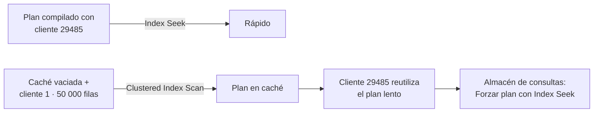

# ⚡ M2 · Optimización del rendimiento

**Optimización del rendimiento de la base de datos**

---

## 📌 De qué trata

Laboratorio de diagnóstico y ajuste de consultas sobre la base de ejemplo **AdventureWorksLT**, ampliada con una tabla `dbo.OrderHistory` de **80 000 pedidos** para obtener planes y estadísticas realistas.

## 📂 Contenido

| Archivo | Descripción |
|---|---|
| [`scripts/M2-lab-query-performance.sql`](scripts/M2-lab-query-performance.sql) | Script completo del laboratorio, de la carga de trabajo a la limpieza |

## 🧩 Qué se puede observar en el script

| # | Sección | Técnica |
|:-:|---|---|
| 1 | Carga de trabajo | Tabla `OrderHistory` con 80 000 filas y columna calculada persistida |
| 2 | Almacén de consultas | Activación en modo `READ_WRITE` y verificación del estado |
| 3 | Plan de ejecución | `Clustered Index Scan` → índice de cobertura → `Index Seek` |
| 4 | DMV | Consultas más costosas por CPU y recomendaciones de índices faltantes |
| 5 | Regresión de plan | *Parameter sniffing* con un procedimiento almacenado y datos desiguales; forzado del plan |
| 6 | Sugerencias del Almacén | `OPTION (MAXDOP 1)` aplicada con `sp_query_store_set_hints` |
| 7 | Bloqueos | Diagnóstico de una cadena de bloqueo entre dos escrituras con DMV |
| 8 | Limpieza | Eliminación de objetos y del forzado de planes |

## 📊 Resultados obtenidos

| Prueba | Antes | Después |
|---|---|---|
| Lecturas lógicas de la consulta por cliente | **897** | **3** |
| Operador de acceso a `OrderHistory` | Clustered Index Scan | Index Seek |
| Tiempo de la agregación (paralelo vs. `MAXDOP 1`) | 7 s | 16 s |

## 🔍 Detección de la regresión

## ▶️ Cómo ejecutarlo

1. Crear una Azure SQL Database con los datos de ejemplo **AdventureWorksLT**.
2. Ejecutar el script por secciones en SSMS, con **Incluir plan de ejecución real** (Ctrl+M) donde se indica.
3. La parte de bloqueos necesita **tres ventanas de consulta** abiertas a la vez.

> Los valores `69` (`query_id`) y `95` (`session_id`) del script son los que se obtuvieron durante la ejecución; en otro entorno serán distintos.

---

[⬅️ M1 · Seguridad](../M1-Seguridad/README.md) · [Inicio](../README.md) · [M3 · CI/CD ➡️](../M3-CICD/README.md)

