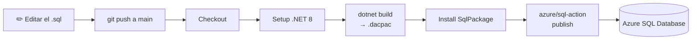

<div align="center">

# 🔄 M3 · CI/CD con proyectos de SQL Database

**Implementación de CI/CD mediante proyectos de SQL Database**


</div>

---

## 📌 De qué trata

El esquema de la base de datos se define de forma **declarativa** en un proyecto de SQL Database, se compila en un paquete `.dacpac` y un flujo de **GitHub Actions** lo despliega en Azure SQL Database con cada push a `main`. Ya nadie ejecuta scripts a mano: el repositorio es la única fuente de verdad del esquema.

## 📂 Contenido

| Ruta | Descripción |
|---|---|
| [`database-project/AdventureWorksDB/`](database-project/AdventureWorksDB) | Proyecto SDK de SQL Database con destino Azure SQL Database (`SqlAzureV12`) |
| ├── `Tables/InventoryLog.sql` | Tabla de registro de inventario (versión final, con la columna `Notes`) |
| └── `StoredProcedures/uspLogInventoryChange.sql` | Procedimiento para registrar cambios de inventario |
| [`pipelines/build-deploy.yml`](pipelines/build-deploy.yml) | Flujo de GitHub Actions: compilar y publicar |
| [`scripts/M3-verificacion.sql`](scripts/M3-verificacion.sql) | Consultas para verificar cada despliegue |

## 🔄 Cómo funciona el pipeline



La acción `publish` compara el `.dacpac` con la base de destino y genera por sí sola los `CREATE` y `ALTER` necesarios.

## 📊 Qué se puede observar

| Ejecución | Commit | Resultado |
|:-:|---|---|
| #1 | Proyecto inicial + pipeline | ❌ Falló: el archivo YAML se subió vacío. No se desplegó nada |
| #2 | Contenido del flujo de trabajo | ✅ Creó `dbo.InventoryLog` y `dbo.uspLogInventoryChange` |
| #3 | Columna `Notes` en la tabla | ✅ El pipeline generó y aplicó el `ALTER TABLE` automáticamente |

> El cambio de la ejecución #3 fue una sola línea en `InventoryLog.sql`; no se escribió ningún `ALTER TABLE`.

## 🔒 Seguridad

La cadena de conexión se guarda como el secreto cifrado `SQL_CONNECTION_STRING` del repositorio y el flujo la lee con `${{ secrets.SQL_CONNECTION_STRING }}`. Nunca aparece en el código ni en los registros.

## ▶️ Cómo reproducirlo

```powershell
dotnet new install Microsoft.Build.Sql.Templates
dotnet build                      # dentro de database-project/AdventureWorksDB
gh secret set SQL_CONNECTION_STRING
```

Para usar el flujo, se copia `pipelines/build-deploy.yml` a `.github/workflows/` de un repositorio que tenga el proyecto en su raíz.

> En este repositorio el YAML está en `pipelines/` a propósito, para que no se ejecute aquí: este repositorio no tiene el secreto configurado. El pipeline se ejecutó en el repositorio del laboratorio, `AdventureWorksDB`.

---

<div align="center">

[⬅️ M2 · Rendimiento](../M2-Rendimiento/README.md) · [Inicio](../README.md) · [M4 · Data API Builder ➡️](../M4-Data-API-Builder/README.md)

</div>
