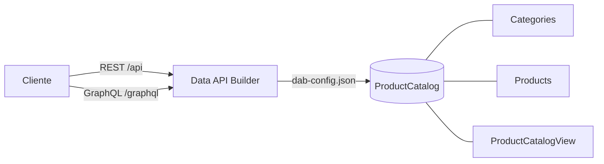

<div align="center">

# 🌐 M4 · Integración con servicios de Azure

**Integración de soluciones SQL con servicios de Azure**


</div>

---

## 📌 De qué trata

Con **Data API Builder (DAB)** se publicó una base de datos de catálogo de productos como **API REST y GraphQL** a partir de un único archivo de configuración, sin escribir código de servidor.

## 📂 Contenido

| Archivo | Descripción |
|---|---|
| [`config/dab-config.json`](config/dab-config.json) | Configuración final de DAB con las entidades `Category`, `Product` y `ProductCatalog` |
| [`scripts/M4-lab-product-catalog.sql`](scripts/M4-lab-product-catalog.sql) | Base `ProductCatalog`: tablas, vista, datos de ejemplo y limpieza |

## 🏗️ Arquitectura



## 🧩 Qué se puede observar en la configuración

| Entidad | Origen | Permisos | Detalles |
|---|---|---|---|
| `Category` | `dbo.Categories` | `anonymous: read` | Relación `products` (uno a muchos) |
| `Product` | `dbo.Products` | `anonymous: read` · `authenticated: *` | Mapeos de campos y relación `category` |
| `ProductCatalog` | `dbo.ProductCatalogView` | `anonymous: read` | Vista de solo lectura con `key-fields: ProductID` |

**Mapeos de `Product`:** `ProductID → id` · `ProductName → name` · `UnitPrice → price` · `UnitsInStock → stockQuantity` · `Discontinued → isDiscontinued`

## 🔎 Ejemplos

**REST:** `GET http://localhost:5000/api/Product`

```json
{ "id": 1, "name": "Wireless Headphones", "price": 79.99, "stockQuantity": 50, "isDiscontinued": false }
```

**GraphQL:** cada producto junto con su categoría, en una sola consulta

```graphql
query {
  products {
    items {
      id
      name
      price
      category {
        CategoryName
      }
    }
  }
}
```

## ▶️ Cómo ejecutarlo

```powershell
dotnet tool install --global Microsoft.DataApiBuilder --version 1.7.90
$env:DATABASE_CONNECTION_STRING="Server=<servidor>.database.windows.net;Database=ProductCatalog;User Id=<usuario>;Password=<TU_CONTRASEÑA>;TrustServerCertificate=true"
dab start
```

> Se usó la versión **1.7.90** porque la más reciente no se instala con .NET SDK 8, el mínimo que pide el laboratorio.

## 🔒 Seguridad

`dab-config.json` no contiene credenciales: la conexión se lee de la variable de entorno con `@env('DATABASE_CONNECTION_STRING')`.

---

<div align="center">

[⬅️ M3 · CI/CD](../M3-CICD/README.md) · [Inicio](../README.md)

</div>
