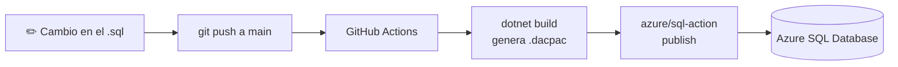
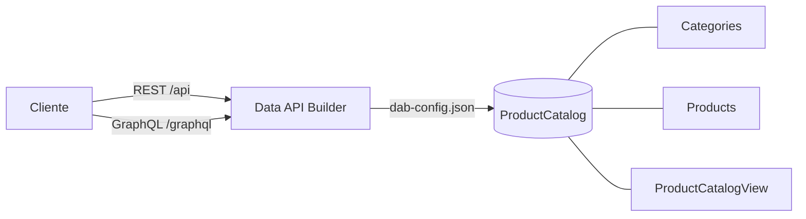

<div align="center">

# 🛡️ Protección, optimización e implementación de soluciones de base de datos


</div>

---

## 📌 Descripción

Repositorio con el código de los laboratorios de la ruta de Microsoft Learn
[*Protección, optimización e implementación de soluciones de base de datos*](https://learn.microsoft.com/es-es/training/paths/secure-optimize-deploy-database-solutions/),
ejecutados sobre **Azure SQL Database**: scripts T-SQL, el proyecto de SQL Database, el pipeline de CI/CD en YAML y la configuración de Data API Builder.

Se usó el código oficial de cada laboratorio. Las pocas adaptaciones necesarias por el entorno están señaladas en comentarios dentro de cada script.

## 🗺️ Módulos

| | Módulo | Qué se hizo | Código |
|:-:|---|---|---|
| 🔐 | **M1 · Seguridad y cumplimiento** | Enmascaramiento dinámico de datos y seguridad a nivel de fila (RLS) por región | [`M1-Seguridad`](M1-Seguridad/scripts) |
| ⚡ | **M2 · Optimización del rendimiento** | Planes de ejecución, índice de cobertura, DMV, Almacén de consultas, forzado de planes, sugerencias MAXDOP y diagnóstico de bloqueos | [`M2-Rendimiento`](M2-Rendimiento/scripts) |
| 🔄 | **M3 · CI/CD con proyectos de SQL Database** | Proyecto SDK `.sqlproj`, compilación a `.dacpac` y despliegue automático con GitHub Actions | [`M3-CICD`](M3-CICD) |
| 🌐 | **M4 · Integración con servicios de Azure** | API REST y GraphQL con Data API Builder: entidades, mapeos, relaciones y vistas | [`M4-Data-API-Builder`](M4-Data-API-Builder) |

## 📊 Resultados destacados

- **M2:** un índice de cobertura redujo las lecturas lógicas de una consulta de **897 a 3**.
- **M2:** se detectó una regresión por *parameter sniffing* en el Almacén de consultas y se corrigió forzando el plan con *Index Seek*.
- **M3:** al agregar una columna en la definición de la tabla, el pipeline generó y aplicó el `ALTER TABLE` sin intervención manual.
- **M4:** una sola consulta GraphQL devuelve cada producto junto con su categoría gracias a las relaciones configuradas.

## 🔄 Flujo de CI/CD (M3)



## 🌐 Arquitectura de la API (M4)



## 📁 Estructura del repositorio

```text
pfbd-2026/
├── M1-Seguridad/
│   ├── scripts/M1-lab-security-compliance.sql
│   └── README.md
├── M2-Rendimiento/
│   ├── scripts/M2-lab-query-performance.sql
│   └── README.md
├── M3-CICD/
│   ├── database-project/AdventureWorksDB/    # Proyecto SQL (SqlAzureV12)
│   ├── pipelines/build-deploy.yml             # Flujo de GitHub Actions
│   ├── scripts/M3-verificacion.sql
│   └── README.md
├── M4-Data-API-Builder/
│   ├── config/dab-config.json                 # Configuración de DAB
│   ├── scripts/M4-lab-product-catalog.sql
│   └── README.md
└── README.md
```

## 🛠️ Herramientas

| Herramienta | Uso |
|---|---|
| Azure SQL Database (oferta gratuita, serverless) | Base de datos de los laboratorios |
| SQL Server Management Studio 22 | Ejecución de scripts y análisis de planes |
| Visual Studio Code + extensión MSSQL | Proyecto de SQL Database y configuración de DAB |
| .NET SDK 8 · Microsoft.Build.Sql | Compilación del proyecto a `.dacpac` |
| Git · GitHub CLI · GitHub Actions | Control de versiones y pipeline de CI/CD |
| Data API Builder 1.7.90 | API REST y GraphQL |

## 🔒 Seguridad

- El repositorio **no contiene credenciales**. Las contraseñas aparecen solo como `<TU_CONTRASEÑA>`.
- En M3, la cadena de conexión se guarda como el secreto cifrado `SQL_CONNECTION_STRING` de GitHub.
- En M4, DAB lee la conexión de una variable de entorno mediante `@env('DATABASE_CONNECTION_STRING')`.

## 📚 Referencias

- Ruta de aprendizaje: [Protección, optimización e implementación de soluciones de base de datos](https://learn.microsoft.com/es-es/training/paths/secure-optimize-deploy-database-solutions/)
- Laboratorios: [MicrosoftLearning / mslearn-sql-developer](https://microsoftlearning.github.io/mslearn-sql-developer/)

---

<div align="center">

Proyecto académico · Base de Datos · 2026

</div>
